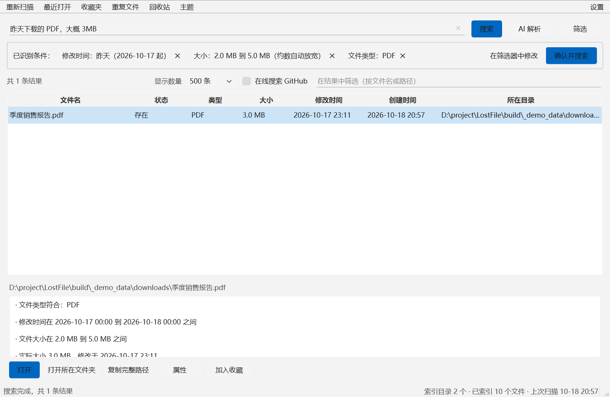
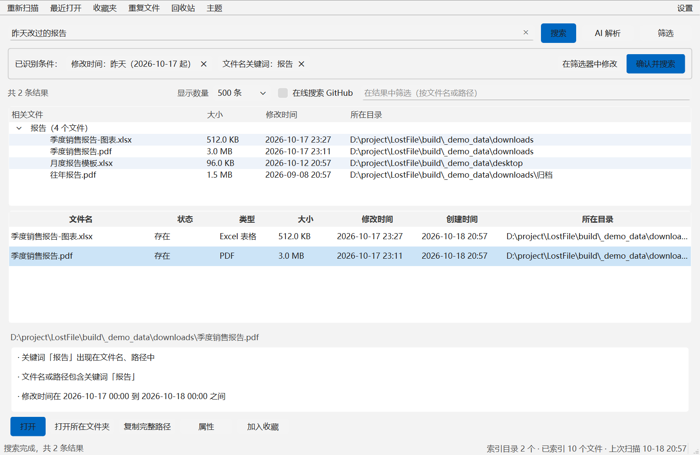
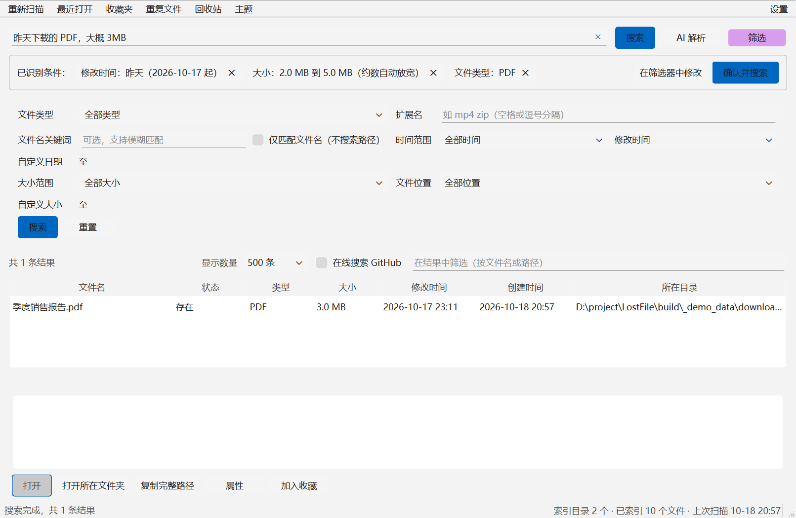
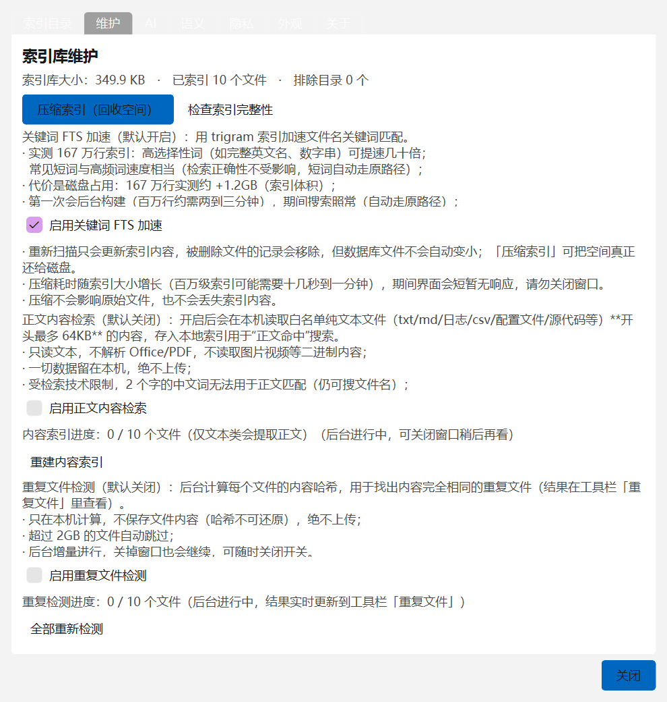
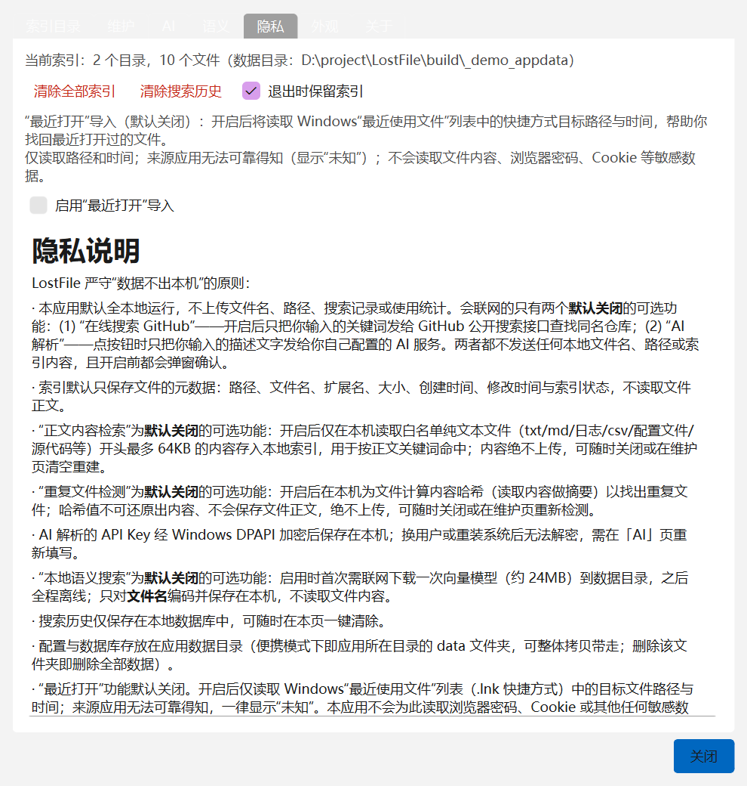
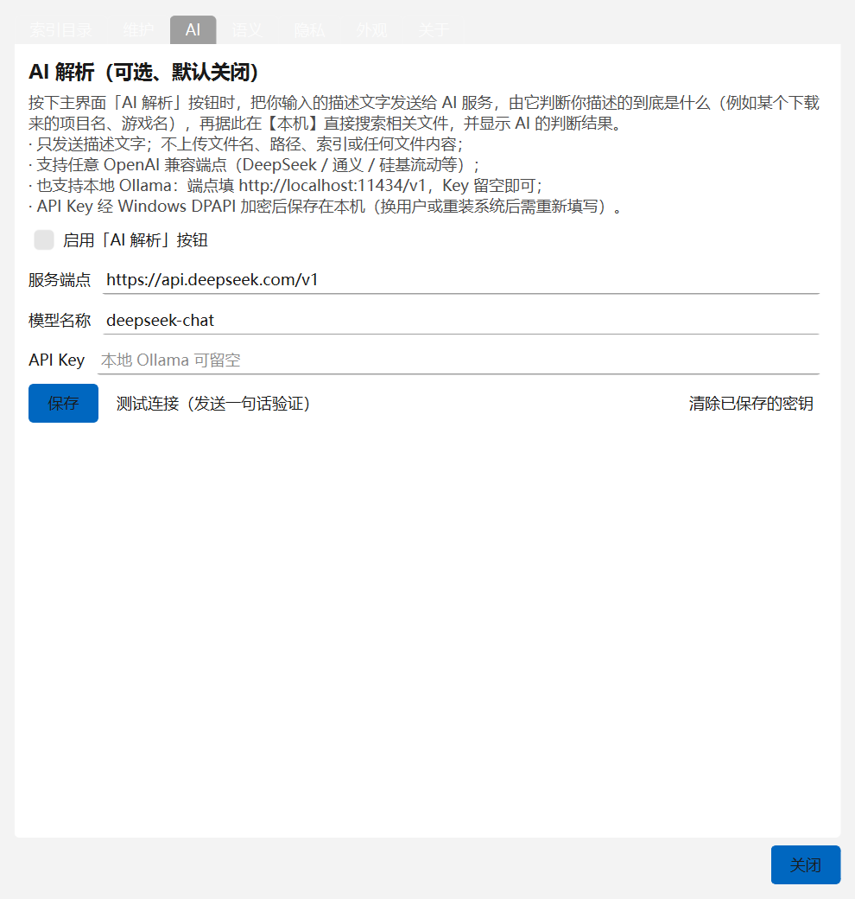
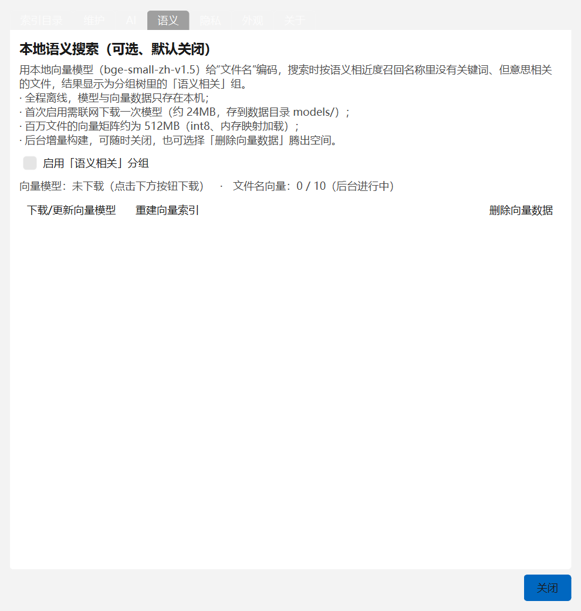

# LostFile

> 忘记文件名没关系——把“记忆中的样子”告诉它，帮你把文件找回来。

LostFile 是一款 **本地运行的 Windows 文件查找工具**。与传统文件搜索不同，你不需要知道文件名，只要还记得文件的大致 **类型、时间、大小、位置**，甚至可以直接用一句日常中文描述它：

- “昨天下载的 PDF，大概 3MB。”
- “上周修改的图片。”
- “下载目录里超过 100MB 的视频。”
- “最近一个月创建的 Word 文档。”

LostFile 会把这句话解析成可编辑的搜索条件，显示给你确认，并解释每个结果 **为什么被找到**。

**默认全程本地运行：默认不读取文件内容、不上传任何本地信息、不需要 API Key 或数据库服务器。**（联网与内容读取能力全部是**默认关闭**的可选功能——「在线搜索 GitHub」「AI 解析」只发送你输入的文字，语义模型首次启用才下载一次约 24MB，见下方隐私说明。）



## 功能特性

- **多条件组合搜索**：文件类型（图片/视频/音频/PDF/Word/Excel/PPT/压缩包/安装包/文本/代码等）、时间范围（今天/昨天/最近 7 天/最近 30 天/自定义）、大小范围（<1MB / 1–10MB / 10–100MB / >100MB / 自定义）、文件位置、文件名关键词、扩展名、创建/修改时间。
- **中文自然语言搜索**：本地规则解析为主（无 AI、无联网），解析出的条件以标签形式回显，可移除、可在筛选器中修改；无法理解的部分会如实提示，绝不假装听懂。另有**可选「AI 解析」按钮**（默认关闭、手动触发，只发送描述文字）把复杂句式拆成同样的条件标签，失败自动回退本地解析。
- **两栏结果**：上栏「相关文件」按关键词折叠分组（点三角展开、双击打开），**名称变体**（`project-notes` / `project_notes` / `projectnotes` 视为同一个名字）与**拼音/同音**（输入 `jianli` 能召回「简历」；`模版` 与 `模板` 这类同音错写也能互相召回）都能召回；下栏是按全部条件筛选的正式结果，点表头排序、选中行可看匹配原因。两栏高度可拖动调整。
- **没找到也不至于白找**：关键词无命中时按「位置 → 时间 → 大小 → 类型」逐级放宽（**始终保留关键词**，横幅写明放宽了什么）；拼写记错给出“你是不是要找”的候选；仍无结果则回落到最近修改的**少量**文件（绝不把整个索引当结果列出来）。
- **匹配原因解释**：每个结果说明它满足哪些条件（类型、时间、大小、位置）以及关键词命中的位置，并标注文件是否仍然存在（已删除/移动会明确标出）。
- **用户自选索引范围 + 常用目录一键添加**：引导页与设置里可一键添加系统下载/桌面/文档，以及自动探测到的**其他盘上的桌面/下载/文档/视频/图片/音乐**等文件夹（很多人把文件放在 `D:\桌面` 这类位置）；**绝不默认扫描整个磁盘**；支持增量更新、暂停/取消扫描、排除目录与文件类型。
- **显示数量可选**：结果表支持 500 / 2000 / 不限——选「不限」时分页加载，列表下方出现「加载更多」逐页追加直到全部显示；被截断时标题显示“显示 N / 共 M 个文件”。
- **索引维护**：设置 → 维护 可查看索引库大小、**压缩索引（回收磁盘空间）**、检查索引完整性。
- **结果操作**：打开、打开所在文件夹、复制完整路径、**复制文件名**、查看属性、加入收藏、在结果中筛选；右键可**删除到回收站**（单个文件、需确认、移入回收站可随时还原，绝不永久删除，也不提供批量删除）。工具栏提供**收藏夹**与**回收站**入口。
- **顺手的小设计**：记住窗口大小、结果区分栏与列宽、上次搜索词；快捷键 `Ctrl+F` 搜索、`F5` 重新扫描、`Ctrl+C` 复制路径、`Enter` 打开、`Delete` 删除到回收站。
- **海量索引也飞快（可关闭）**：关键词匹配由 SQLite FTS5（trigram）加速，与旧实现逐例对拍保证结果一致；实测 167 万行索引下，高选择性词（完整英文名、数字串）从约 3 秒降到数十毫秒，常见短词与原来相当。占用磁盘约 +1.2GB/167万行，可在 设置 → 维护 关闭并一键删除（自动回退原路径，结果不变）。
- **可选“AI 解析”按钮（默认关闭）**：点一下由 AI 联网分析你描述的东西到底是什么（例如某个下载来的项目名、游戏名），给出名称线索并**直接在本机搜索出相关文件**，同时展示 AI 的判断；支持 OpenAI 兼容端点（DeepSeek/通义/硅基流动/**本地 Ollama** 等，自填端点与 Key）；只发送描述文字，Key 经 Windows DPAPI 加密存本机；失败自动回退本地规则解析。
- **可选“正文内容检索”（默认关闭）**：在本机提取纯文本文件（txt/md/日志/csv/配置/源代码等）**开头最多 16KB** 建立全文索引，并跳过 node_modules、site-packages、.git、build、dist 等依赖/构建目录，索引体积可控；搜索时以「内容命中」分组展示并悬浮看片段；2 字中文为如实说明的已知限制。
- **可选“重复文件检测”（默认关闭）**：按内容哈希找出内容完全相同的文件（名字不同也算），工具栏「重复文件」按组查看可释放空间并逐项确认回收站删除；不保存文件正文。
- **可选“本地语义搜索”（默认关闭）**：bge-small-zh 向量模型对文件名编码，按语义相近度召回「名称不含关键词但意思相关」的文件（「语义相关」分组，悬停看相似度）；首次启用经确认后下载一次约 24MB 模型，之后全离线。
- **可选“在线搜索 GitHub”（默认关闭）**：开启后只把你输入的**关键词**发给 GitHub 公开搜索接口，用来确认某个下载来的东西在网上的出处（例如同名 skill/仓库）；本地文件名、路径与索引内容一律不上传，网络不可用时自动跳过。
- **可选“最近打开”导入**：默认关闭，开启前有明确说明；仅读取 Windows 最近使用记录的路径与时间，来源应用显示“未知”。
- **隐私优先**：默认仅保存文件元数据（路径/名称/扩展名/大小/时间），不读取文件正文；所有联网/内容读取能力默认关闭、开启前确认；一键清除索引与搜索历史；便携模式下数据就在应用目录里。



  

 

## 运行环境与安装

- Windows 10/11（64 位），无需管理员权限。
- **下载**：到 [Releases 页面](https://github.com/Luxumbra47/LostFile/releases)下载最新便携包 `LostFile_v<版本>_win64.zip`，解压即用。
- **免安装**：下载发布包解压后，双击 `LostFile.exe` 即可运行。便携模式下所有数据保存在程序目录的 `data/` 文件夹，删除该文件夹即清除全部数据。
- 删除 `LostFile.exe` 旁的 `portable.txt` 可切换为普通模式（数据保存到 `%APPDATA%\LostFile`）。

## 快速开始（源码运行）

```powershell
# 1. 创建虚拟环境并安装依赖（Python 3.10+）
py -3.12 -m venv .venv
.venv\Scripts\python.exe -m pip install -r requirements.txt

# 2. 运行
.\scripts\run.ps1        # 或 .venv\Scripts\python.exe -m lostfile

# 3. 测试
.\scripts\test.ps1

# 4. 打包 Windows 可运行版本
.\scripts\build.ps1      # 产物在 dist\LostFile\LostFile.exe
```

首次启动会出现引导，选择要索引的目录后开始扫描，之后就可以用自然语言或筛选面板搜索了。

## 使用方式

1. **说人话找文件**：在顶部搜索框输入“昨天的 PDF，大概 3MB”，回车后查看解析出的条件标签（可移除单个条件或到筛选器中修改），点击“确认并搜索”。
2. **条件筛选查找**：点击“筛选”打开多条件面板，类型/时间/大小/位置任意组合。
3. **看原因**：点击结果行，下方面板会解释该文件为什么匹配，并标注文件是否仍然存在。
4. **看懂两栏**：上栏「相关文件」按关键词分组，即使严格条件没命中，也会把同名的相关文件列在这里（点三角展开、双击打开）；下栏是按条件筛出的正式结果，点表头可改排序。
5. **搜不到时**：横幅会说明自动放宽了哪些条件；拼写记错会有“你是不是要找”的候选；若是刚下载/刚安装的文件搜不到，先点工具栏「重新扫描」，或在 设置 → 索引目录 里用「添加常用目录…」把它所在的位置加进来。
6. **常用快捷键**：`Ctrl+F` 聚焦搜索框、`F5` 重新扫描、`Ctrl+L` 清空输入；结果表内 `Enter` 打开、`Ctrl+C` 复制路径、`Delete` 删除到回收站。
7. **省心维护**：设置 → 维护 可查看索引库大小并「压缩索引」回收磁盘空间（重扫删掉的记录不会自动让库文件变小）。
8. **按需增强（全部默认关闭）**：设置 → 维护 开「正文内容检索/重复检测」，设置 → 语义 开「语义相关」分组（首次下载约 24MB 模型），搜索框旁「AI 解析」做复杂描述拆解；工具栏「重复文件」查看去重结果。

完整说明见 [docs/USER_GUIDE.md](docs/USER_GUIDE.md)。

## 隐私

LostFile 默认全本地运行：默认索引只包含文件元数据（路径/名称/扩展名/大小/时间），**默认不读取文件内容**，不上传文件名、路径、搜索记录或统计。

会联网的只有三个**默认关闭**的可选功能，且都只发送最小信息：

- 「在线搜索 GitHub」：只把你输入的**关键词**发给 GitHub 公开搜索接口（`api.github.com`），用于确认下载内容的出处；
- 「AI 解析」：只把你输入的**描述文字**发给你自己配置的 OpenAI 兼容服务；API Key 经 Windows DPAPI 加密存本机；
- 「语义模型下载」：首次启用语义搜索时经确认后下载一次约 24MB 模型到数据目录，之后全程离线。

「正文内容检索」（仅纯文本 ≤16KB，跳过依赖/构建目录）、「重复文件检测」（仅内容哈希、不保存正文）均为本地计算且默认关闭。详见 [docs/PRIVACY.md](docs/PRIVACY.md)。

## 技术栈

Python 3 + PySide6（Qt 6）+ SQLite（WAL 增量索引 + FTS5 trigram 检索加速）+ NumPy/ONNX Runtime（本地语义向量）+ PyInstaller（免安装打包）。设计说明见 [docs/ARCHITECTURE.md](docs/ARCHITECTURE.md)，竞品调研见 [docs/COMPETITIVE_RESEARCH.md](docs/COMPETITIVE_RESEARCH.md)。

## 与同类产品的区别

Everything / WizFile / Listary 等工具需要输入文件名或学习操作符语法；LostFile 面向普通用户，用**中文描述 + 可视化条件 + 匹配原因**来找文件，并且索引范围完全由用户决定。详细对比见竞品调研文档。

## 开源协议

[MIT License](LICENSE)。欢迎参与：见 [CONTRIBUTING.md](CONTRIBUTING.md)；安全问题反馈见 [SECURITY.md](SECURITY.md)。